# 基于微信小程序的短文写作竞赛管理系统r653y--论文

> 🎓 **计算机毕业设计 · 基于微信小程序的短文写作竞赛管理系统r653y--论文**
>
> 本仓库只放**项目介绍 + 运行截图**（截图是站点带水印的原图，存在仓库 `images/` 里）。
>
> 👉 **完整可运行源码 / 数据库脚本 / 部署文档：[点我获取](https://geekcode.top/archives/%E5%9F%BA%E4%BA%8E%E5%BE%AE%E4%BF%A1%E5%B0%8F%E7%A8%8B%E5%BA%8F%E7%9A%84%E7%9F%AD%E6%96%87%E5%86%99%E4%BD%9C%E7%AB%9E%E8%B5%9B%E7%AE%A1%E7%90%86%E7%B3%BB%E7%BB%9Fr653y-%E8%AE%BA%E6%96%87?utm_source=github)**
>
> 💬 咨询微信：**ir9372**　|　🌐 更多项目：[极客代码 geekcode.top](https://geekcode.top/?utm_source=github)
>
> 📌 项目详情页：<https://geekcode.top/archives/%E5%9F%BA%E4%BA%8E%E5%BE%AE%E4%BF%A1%E5%B0%8F%E7%A8%8B%E5%BA%8F%E7%9A%84%E7%9F%AD%E6%96%87%E5%86%99%E4%BD%9C%E7%AB%9E%E8%B5%9B%E7%AE%A1%E7%90%86%E7%B3%BB%E7%BB%9Fr653y-%E8%AE%BA%E6%96%87?utm_source=github>

<table><td width="230" align="center"> <b>扫码加微信 ir9372</b></td><td valign="middle">📦 源码 = 项目介绍 + 全部运行截图 + 数据库 + 部署文档 👉 点上方任意截图，直接跳到 <b>极客代码 geekcode.top</b> 详情页</td></table>

---

<h1>基于微信小程序的短文写作竞赛管理系统_r653y--论文</h1>
<h2>项目概述</h2>

本项目名为“基于微信小程序的短文写作竞赛管理系统”，旨在构建一个集竞赛发布、报名管理、评审反馈及成果展示于一体的综合性服务平台。系统采用前后端分离架构，后端基于 Java Spring Boot 框架开发，前端包含面向普通用户的微信小程序端和面向管理员的 Web 后台管理端。核心功能涵盖竞赛类别维护、学生与负责人信息管理、竞赛报名流程控制、评委打分记录以及最终结果公示。该项目主要适用于高校或教育机构组织的短文写作类竞赛活动，服务于参赛学生、竞赛组织者（负责人）、评审专家及系统管理员，通过数字化手段提升竞赛管理的效率与透明度。

<h2>技术架构</h2>

本系统采用经典的 B/S 架构结合移动端应用模式，具体技术选型如下：

<ol>
<li><strong>后端架构</strong>：</li>
</ol>
<ul>
<li><strong>核心框架</strong>：使用 Spring Boot 作为基础框架，简化配置并快速搭建 RESTful API 服务。</li>
<li><strong>持久层</strong>：集成 MyBatis-Plus 作为 ORM 框架，提供高效的数据库操作能力，支持通用 CRUD 及复杂查询。</li>
<li><strong>安全认证</strong>：引入 Apache Shiro 进行权限管理和身份认证，确保接口访问的安全性。</li>
<li><strong>数据库</strong>：使用 MySQL 存储业务数据，包括用户信息、竞赛详情、报名记录及成绩数据等。</li>
</ul>
<ol start="2">
<li><strong>前端架构</strong>：</li>
</ol>
<ul>
<li><strong>小程序端</strong>：基于微信小程序原生开发或 Vue 生态集成方案，通过 HTTP 请求调用后端提供的 REST API 获取数据并渲染页面。</li>
<li><strong>Web 管理端</strong>：基于 Vue.js 框架构建单页应用（SPA），通过 Axios 等工具与后端交互，实现数据的增删改查及可视化展示。</li>
</ul>
<ol start="3">
<li><strong>交互方式</strong>：
   前后端通过 JSON 格式的数据进行通信。小程序端和 Web 管理端均通过标准的 HTTP/HTTPS 协议向后端 Controller 层发送请求，后端处理后返回统一格式的响应数据。</li>
</ol>

<a href="https://geekcode.top/archives/%E5%9F%BA%E4%BA%8E%E5%BE%AE%E4%BF%A1%E5%B0%8F%E7%A8%8B%E5%BA%8F%E7%9A%84%E7%9F%AD%E6%96%87%E5%86%99%E4%BD%9C%E7%AB%9E%E8%B5%9B%E7%AE%A1%E7%90%86%E7%B3%BB%E7%BB%9Fr653y-%E8%AE%BA%E6%96%87?utm_source=github" title="查看完整源码">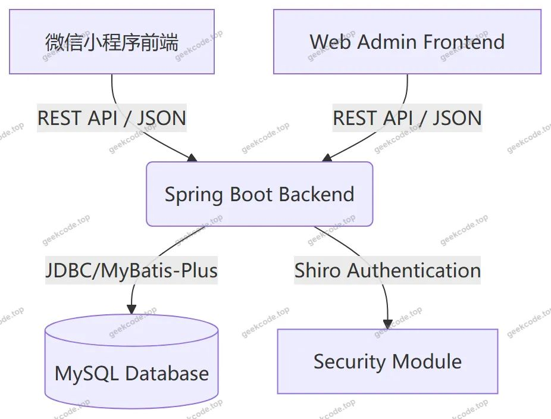</a>

<h2>功能模块</h2>

根据代码上下文中的 Controller 列表、路由配置及截图所示界面，系统功能划分为以下两大模块：

<h3>1. 微信小程序用户端</h3>

小程序端主要面向学生、负责人、游客及评委等角色，提供便捷的移动化操作体验。

<ul>
<li><strong>用户认证模块</strong>：</li>
<li><strong>登录/注册</strong>：支持用户通过手机号或账号密码进行身份验证，区分不同角色入口。</li>
<li><strong>个人信息管理</strong>：查看和编辑个人基本资料。</li>
<li><strong>竞赛参与模块</strong>：</li>
<li><strong>首页展示</strong>：聚合展示最新公告、热门竞赛等信息。</li>
<li><strong>竞赛信息查询</strong>：浏览竞赛类别、竞赛详细信息（时间、规则、要求）。</li>
<li><strong>竞赛报名</strong>：填写报名表单，提交参赛申请，并可查看个人的“竞赛报名列表”。</li>
<li><strong>成果与评审模块</strong>：</li>
<li><strong>成果详情</strong>：查看已提交的参赛作品详细内容。</li>
<li><strong>结果展示</strong>：查看竞赛的最终排名、获奖情况及评委点评。</li>
<li><strong>管理辅助模块</strong>（针对特定角色如负责人）：</li>
<li><strong>人员管理</strong>：查看负责人列表、学生列表、游客列表、评委列表。</li>
<li><strong>基础数据查看</strong>：浏览专业列表、班级列表、竞赛类别列表。</li>
<li><strong>公告栏</strong>：接收和管理系统发布的通知公告。</li>
</ul>
<h3>2. Web 后台管理端</h3>

后台管理端主要面向超级管理员，用于全局数据维护和系统配置。

<ul>
<li><strong>系统配置与管理</strong>：</li>
<li><strong>登录页</strong>：管理员专属入口。</li>
<li><strong>后台首页</strong>：数据概览与快捷操作面板。</li>
<li><strong>参数配置</strong>：对系统全局参数进行管理（对应 <code>/config</code> 路由及 <code>ConfigController</code>）。</li>
<li><strong>基础数据管理</strong>：</li>
<li><strong>新闻/公告管理</strong>：发布和维护系统通知（对应 <code>/news</code> 路由及 <code>NewsController</code>）。</li>
<li><strong>竞赛类别管理</strong>：定义竞赛的分类体系（对应 <code>/jingsaileibie</code> 路由及 <code>JingsaileibieController</code>）。</li>
<li><strong>专业与班级管理</strong>：维护学校或机构的专业及班级基础数据（对应 <code>/zhuanye</code>, <code>/banji</code> 路由及相应 Controller）。</li>
<li><strong>岗位/职位管理</strong>：管理评委或工作人员的职位信息（对应 <code>/pingwei</code> 路由及 <code>PingweiController</code>）。</li>
<li><strong>用户与角色管理</strong>：</li>
<li><strong>学生管理</strong>：录入、修改、删除学生信息（对应 <code>/xuesheng</code> 路由及隐含逻辑）。</li>
<li><strong>负责人管理</strong>：管理竞赛组织负责人的账号与信息（对应 <code>/fuzeren</code> 路由及 <code>FuzerenController</code>）。</li>
<li><strong>游客管理</strong>：管理未注册或非正式用户的访问记录（对应 <code>/youke</code> 路由及隐含逻辑）。</li>
<li><strong>业务流程管理</strong>：</li>
<li><strong>竞赛信息管理</strong>：创建、编辑、上下架具体的竞赛活动（对应 <code>/jingsaixinxi</code> 路由及 <code>JingsaixinxiController</code>）。</li>
<li><strong>竞赛报名审核</strong>：处理学生的报名申请，确认参赛资格（对应 <code>/jingsaibaoming</code> 路由及 <code>JingsaibaomingController</code>）。</li>
<li><strong>成果详情管理</strong>：上传或管理参赛作品的具体内容（对应 <code>/chengguoxiangqing</code> 路由及 <code>ChengguoxiangqingController</code>）。</li>
<li><strong>结果展示管理</strong>：配置最终成绩的发布范围和显示方式（对应 <code>/jieguozhanshi</code> 路由及 <code>JieguozhanshiController</code>）。</li>
<li><strong>文件服务</strong>：处理图片、文档等文件的上传与下载（对应 <code>FileController</code>）。</li>
</ul>
<h2>用户角色与权限</h2>

系统设计了多角色权限体系，以确保数据的安全性和操作的规范性。

<ol>
<li><strong>超级管理员 (Admin)</strong>：</li>
</ol>
<ul>
<li><strong>权限范围</strong>：拥有最高权限，可访问 Web 后台所有模块。负责系统配置、基础数据（专业、班级、类别）的初始化与维护，以及所有用户账号的管理。</li>
<li><strong>操作能力</strong>：CRUD（增删改查）所有业务实体，包括竞赛发布、报名审批、成绩录入与发布。</li>
</ul>
<ol start="2">
<li><strong>负责人 (Organizer/Fuzeren)</strong>：</li>
</ol>
<ul>
<li><strong>权限范围</strong>：主要负责竞赛的组织工作。在小程序端可查看相关管理列表（如学生、评委、公告等），协助管理员进行部分信息的核对与维护。</li>
<li><strong>操作能力</strong>：侧重于竞赛信息的执行层面管理，如查看报名情况、协调评委资源。</li>
</ul>
<ol start="3">
<li><strong>学生 (Student/Xuesheng)</strong>：</li>
</ol>
<ul>
<li><strong>权限范围</strong>：主要使用者。仅能访问自己的相关信息及公开的竞赛内容。</li>
<li><strong>操作能力</strong>：注册登录、浏览竞赛、提交报名、上传作品、查看个人成绩及排名。无权查看其他学生的详细隐私数据或修改系统设置。</li>
</ul>
<ol start="4">
<li><strong>评委 (Judge/Pingwei)</strong>：</li>
</ol>
<ul>
<li><strong>权限范围</strong>：专注于评分环节。</li>
<li><strong>操作能力</strong>：查看分配给自己的参赛作品，进行打分和评语撰写。（注：根据现有截图和Controller，评委主要在后台被管理，其具体打分界面可能在小程序端或通过特定链接进入，此处依据“成果详情”和“结果展示”推断其参与评分流程）。</li>
</ul>
<ol start="5">
<li><strong>游客 (Guest/Youke)</strong>：</li>
</ol>
<ul>
<li><strong>权限范围</strong>：受限访问。</li>
<li><strong>操作能力</strong>：通常只能浏览公开的公告、竞赛基本信息，无法进行报名、查看成绩或管理任何数据。需注册成为学生或登录后方可使用完整功能。</li>
</ul>
<h2>项目特色与创新点</h2>
<ol>
<li>
<strong>双端协同的高效管理</strong>：
   创新性地结合了微信小程序的便捷性与 Web 后台的强大管理能力。学生利用碎片化时间在手机端完成报名和查看结果，管理员则在 PC 端进行大规模数据清洗和流程控制，实现了场景互补。

</li>
<li>
<strong>全流程数字化闭环</strong>：
   覆盖了从“竞赛定义 -&gt; 信息发布 -&gt; 在线报名 -&gt; 作品提交 -&gt; 专家评审 -&gt; 结果公示”的完整生命周期。通过 <code>Jingsaibaoming</code>（报名）、<code>Chengguoxiangqing</code>（成果）、<code>Jieguozhanshi</code>（结果）等模块的紧密衔接，消除了传统纸质竞赛管理中的数据孤岛和人工误差。

</li>
<li>
<strong>细粒度的角色权限隔离</strong>：
   基于 Shiro 框架实现了严格的 RBAC（基于角色的访问控制）。将管理员、负责人、学生、评委、游客五种角色清晰划分，确保了敏感数据（如学生个人信息、未公布的成绩）仅在授权范围内可见，保障了竞赛的公平性与数据安全性。

</li>
<li>
<strong>模块化基础数据支撑</strong>：
   独立设计了 <code>Banji</code>（班级）、<code>Zhuanye</code>（专业）、<code>Pingwei</code>（职位/评委）等基础字典模块，使得竞赛系统能够灵活适配不同院系、不同年级的复杂组织结构，具备良好的可扩展性。

</li>
</ol>
<h2>部署环境</h2>

为确保系统正常运行，建议部署以下软硬件环境：

<ol>
<li><strong>硬件环境</strong>：</li>
</ol>
<ul>
<li>CPU: Intel Core i5 及以上</li>
<li>内存: 8GB RAM 及以上</li>
<li>硬盘: SSD 128GB 及以上</li>
</ul>
<ol start="2">
<li><strong>软件环境</strong>：</li>
</ol>
<ul>
<li><strong>操作系统</strong>：Windows 10/11, Linux (CentOS 7+, Ubuntu 18.04+)</li>
<li><strong>Java 运行环境</strong>：JDK 1.8 或 JDK 11（Spring Boot 兼容性良好版本）</li>
<li><strong>数据库</strong>：MySQL 5.7 或 MySQL 8.0</li>
<li><strong>Maven</strong>：3.6+ （用于后端依赖管理）</li>
<li><strong>Node.js</strong>：12.x 或 14.x LTS （用于前端/Web后台构建，若涉及 npm 包管理）</li>
<li><strong>微信开发者工具</strong>：最新版（用于小程序端的调试与预览）</li>
<li><strong>浏览器</strong>：Chrome, Edge, Firefox 等现代浏览器（用于访问 Web 管理后台）</li>
</ul>
<ol start="3">
<li><strong>网络环境</strong>：</li>
</ol>
<ul>
<li>服务器需开放 80/443 端口（HTTP/HTTPS）以提供 API 服务。</li>
<li>小程序真机调试或上线需配置合法的域名白名单。</li>
</ul>
<h2>五、技术特性</h2>
<ul>
<li>前后端集成部署，前端资源打包至后端 static 目录</li>
<li>使用 MyBatis-Plus 简化数据访问层开发</li>
<li>集成 Shiro 权限框架实现角色权限控制</li>
</ul>
<h2>六、功能模块截图</h2>
<h3>微信小程序用户端</h3>

<figure><a href="https://geekcode.top/archives/%E5%9F%BA%E4%BA%8E%E5%BE%AE%E4%BF%A1%E5%B0%8F%E7%A8%8B%E5%BA%8F%E7%9A%84%E7%9F%AD%E6%96%87%E5%86%99%E4%BD%9C%E7%AB%9E%E8%B5%9B%E7%AE%A1%E7%90%86%E7%B3%BB%E7%BB%9Fr653y-%E8%AE%BA%E6%96%87?utm_source=github" title="查看完整源码">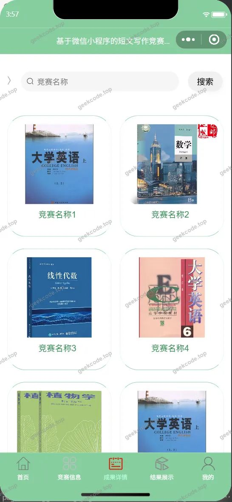</a><figcaption>小程序-成果详情</figcaption></figure>
<figure><a href="https://geekcode.top/archives/%E5%9F%BA%E4%BA%8E%E5%BE%AE%E4%BF%A1%E5%B0%8F%E7%A8%8B%E5%BA%8F%E7%9A%84%E7%9F%AD%E6%96%87%E5%86%99%E4%BD%9C%E7%AB%9E%E8%B5%9B%E7%AE%A1%E7%90%86%E7%B3%BB%E7%BB%9Fr653y-%E8%AE%BA%E6%96%87?utm_source=github" title="查看完整源码">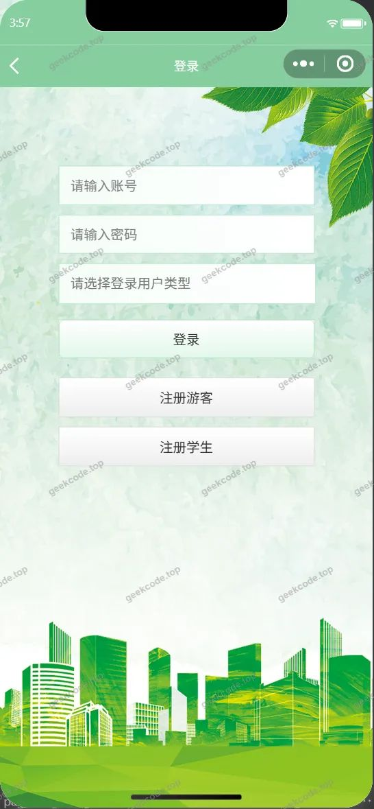</a><figcaption>小程序-登录</figcaption></figure>
<figure><figcaption>小程序-个人信息</figcaption></figure>
<figure><a href="https://geekcode.top/archives/%E5%9F%BA%E4%BA%8E%E5%BE%AE%E4%BF%A1%E5%B0%8F%E7%A8%8B%E5%BA%8F%E7%9A%84%E7%9F%AD%E6%96%87%E5%86%99%E4%BD%9C%E7%AB%9E%E8%B5%9B%E7%AE%A1%E7%90%86%E7%B3%BB%E7%BB%9Fr653y-%E8%AE%BA%E6%96%87?utm_source=github" title="查看完整源码">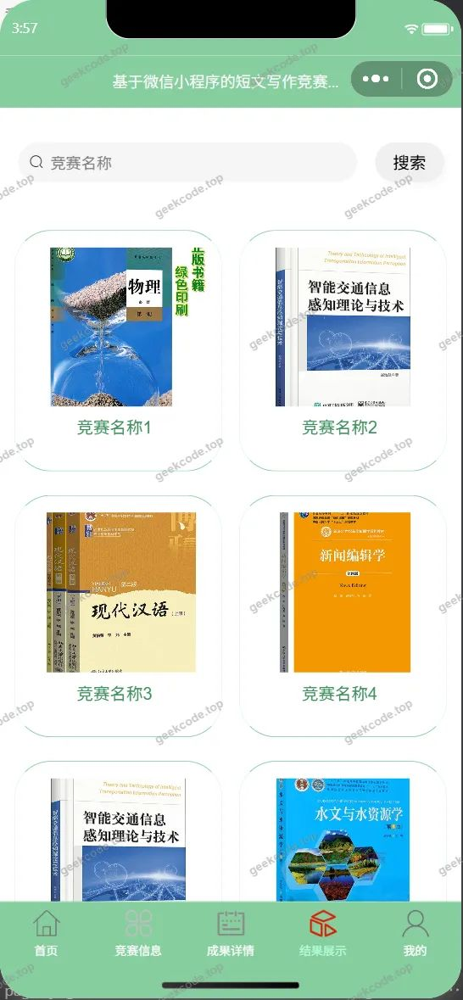</a><figcaption>小程序-结果展示</figcaption></figure>
<figure><figcaption>小程序-竞赛报名列表</figcaption></figure>
<figure><a href="https://geekcode.top/archives/%E5%9F%BA%E4%BA%8E%E5%BE%AE%E4%BF%A1%E5%B0%8F%E7%A8%8B%E5%BA%8F%E7%9A%84%E7%9F%AD%E6%96%87%E5%86%99%E4%BD%9C%E7%AB%9E%E8%B5%9B%E7%AE%A1%E7%90%86%E7%B3%BB%E7%BB%9Fr653y-%E8%AE%BA%E6%96%87?utm_source=github" title="查看完整源码">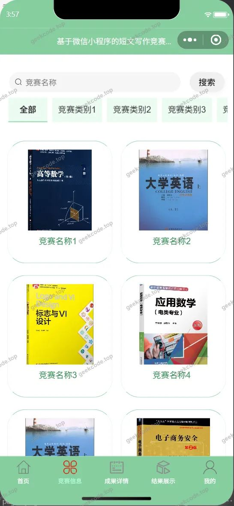</a><figcaption>小程序-竞赛信息</figcaption></figure>
<figure><a href="https://geekcode.top/archives/%E5%9F%BA%E4%BA%8E%E5%BE%AE%E4%BF%A1%E5%B0%8F%E7%A8%8B%E5%BA%8F%E7%9A%84%E7%9F%AD%E6%96%87%E5%86%99%E4%BD%9C%E7%AB%9E%E8%B5%9B%E7%AE%A1%E7%90%86%E7%B3%BB%E7%BB%9Fr653y-%E8%AE%BA%E6%96%87?utm_source=github" title="查看完整源码">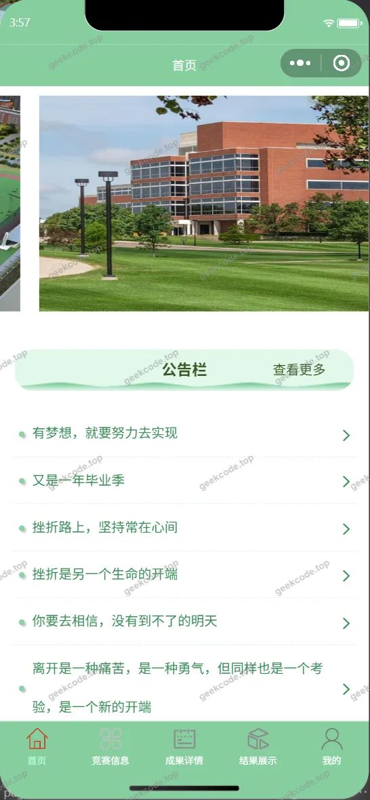</a><figcaption>小程序-首页</figcaption></figure>
<figure><a href="https://geekcode.top/archives/%E5%9F%BA%E4%BA%8E%E5%BE%AE%E4%BF%A1%E5%B0%8F%E7%A8%8B%E5%BA%8F%E7%9A%84%E7%9F%AD%E6%96%87%E5%86%99%E4%BD%9C%E7%AB%9E%E8%B5%9B%E7%AE%A1%E7%90%86%E7%B3%BB%E7%BB%9Fr653y-%E8%AE%BA%E6%96%87?utm_source=github" title="查看完整源码">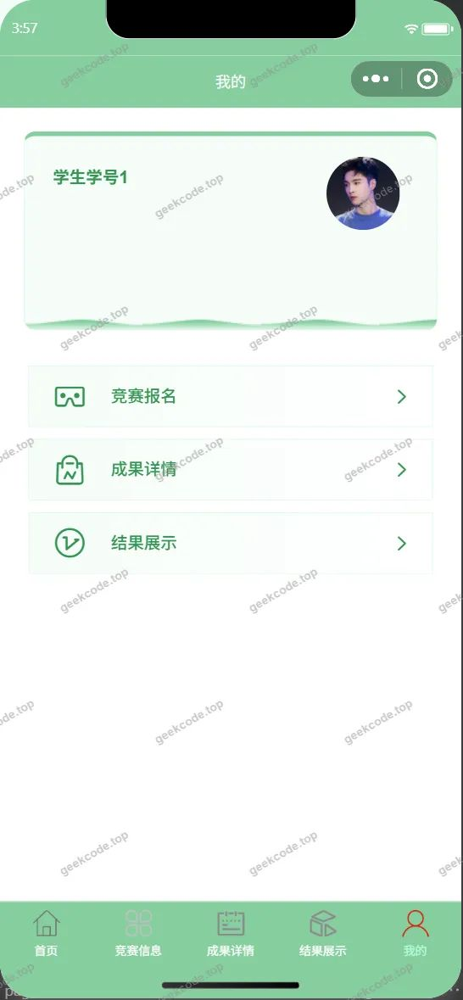</a><figcaption>小程序-我的</figcaption></figure>
<figure><a href="https://geekcode.top/archives/%E5%9F%BA%E4%BA%8E%E5%BE%AE%E4%BF%A1%E5%B0%8F%E7%A8%8B%E5%BA%8F%E7%9A%84%E7%9F%AD%E6%96%87%E5%86%99%E4%BD%9C%E7%AB%9E%E8%B5%9B%E7%AE%A1%E7%90%86%E7%B3%BB%E7%BB%9Fr653y-%E8%AE%BA%E6%96%87?utm_source=github" title="查看完整源码">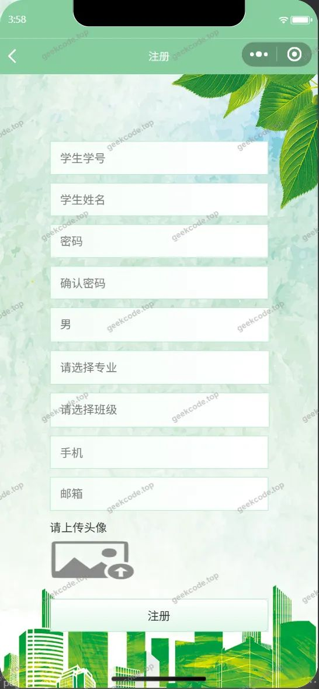</a><figcaption>小程序-注册</figcaption></figure>

<h3>微信小程序管理端</h3>

<figure><figcaption>小程序-管理端-班级列表</figcaption></figure>
<figure><a href="https://geekcode.top/archives/%E5%9F%BA%E4%BA%8E%E5%BE%AE%E4%BF%A1%E5%B0%8F%E7%A8%8B%E5%BA%8F%E7%9A%84%E7%9F%AD%E6%96%87%E5%86%99%E4%BD%9C%E7%AB%9E%E8%B5%9B%E7%AE%A1%E7%90%86%E7%B3%BB%E7%BB%9Fr653y-%E8%AE%BA%E6%96%87?utm_source=github" title="查看完整源码">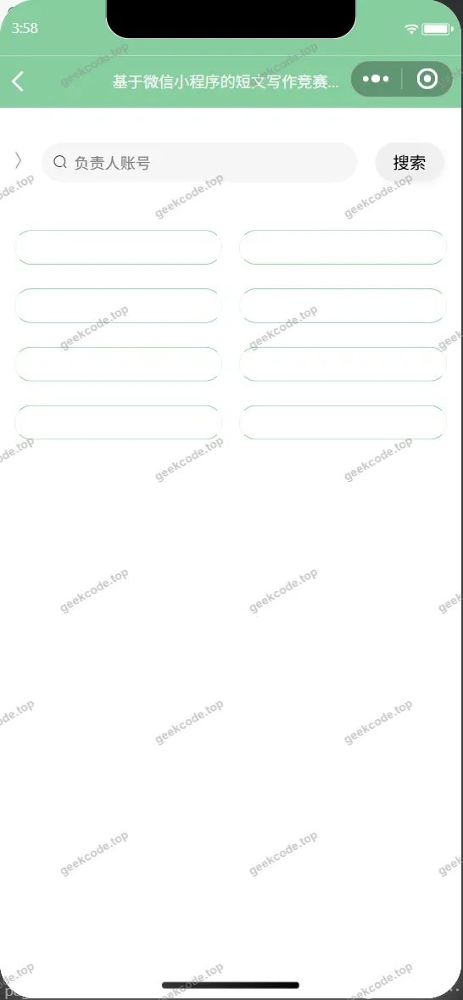</a><figcaption>小程序-管理端-负责人列表</figcaption></figure>
<figure><a href="https://geekcode.top/archives/%E5%9F%BA%E4%BA%8E%E5%BE%AE%E4%BF%A1%E5%B0%8F%E7%A8%8B%E5%BA%8F%E7%9A%84%E7%9F%AD%E6%96%87%E5%86%99%E4%BD%9C%E7%AB%9E%E8%B5%9B%E7%AE%A1%E7%90%86%E7%B3%BB%E7%BB%9Fr653y-%E8%AE%BA%E6%96%87?utm_source=github" title="查看完整源码">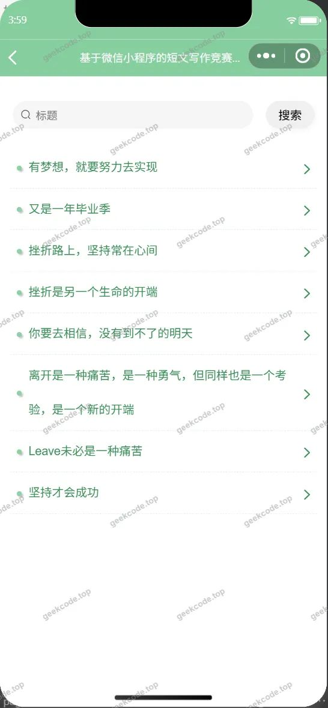</a><figcaption>小程序-管理端-公告栏列表</figcaption></figure>
<figure><a href="https://geekcode.top/archives/%E5%9F%BA%E4%BA%8E%E5%BE%AE%E4%BF%A1%E5%B0%8F%E7%A8%8B%E5%BA%8F%E7%9A%84%E7%9F%AD%E6%96%87%E5%86%99%E4%BD%9C%E7%AB%9E%E8%B5%9B%E7%AE%A1%E7%90%86%E7%B3%BB%E7%BB%9Fr653y-%E8%AE%BA%E6%96%87?utm_source=github" title="查看完整源码">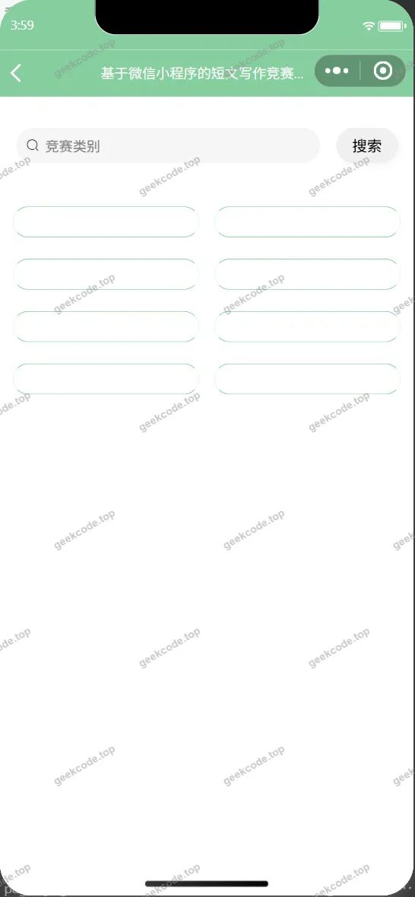</a><figcaption>小程序-管理端-竞赛类别列表</figcaption></figure>
<figure><a href="https://geekcode.top/archives/%E5%9F%BA%E4%BA%8E%E5%BE%AE%E4%BF%A1%E5%B0%8F%E7%A8%8B%E5%BA%8F%E7%9A%84%E7%9F%AD%E6%96%87%E5%86%99%E4%BD%9C%E7%AB%9E%E8%B5%9B%E7%AE%A1%E7%90%86%E7%B3%BB%E7%BB%9Fr653y-%E8%AE%BA%E6%96%87?utm_source=github" title="查看完整源码">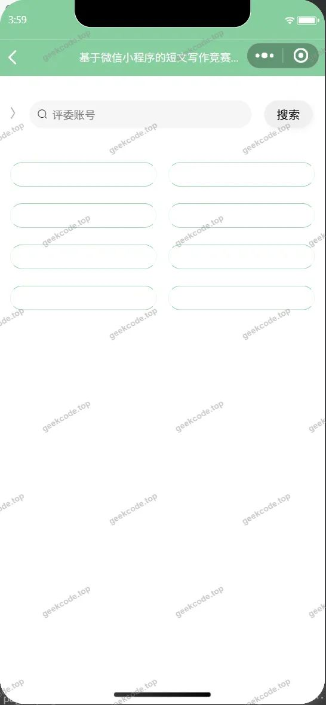</a><figcaption>小程序-管理端-评委列表</figcaption></figure>
<figure><figcaption>小程序-管理端-学生列表</figcaption></figure>
<figure><figcaption>小程序-管理端-游客列表</figcaption></figure>
<figure><a href="https://geekcode.top/archives/%E5%9F%BA%E4%BA%8E%E5%BE%AE%E4%BF%A1%E5%B0%8F%E7%A8%8B%E5%BA%8F%E7%9A%84%E7%9F%AD%E6%96%87%E5%86%99%E4%BD%9C%E7%AB%9E%E8%B5%9B%E7%AE%A1%E7%90%86%E7%B3%BB%E7%BB%9Fr653y-%E8%AE%BA%E6%96%87?utm_source=github" title="查看完整源码">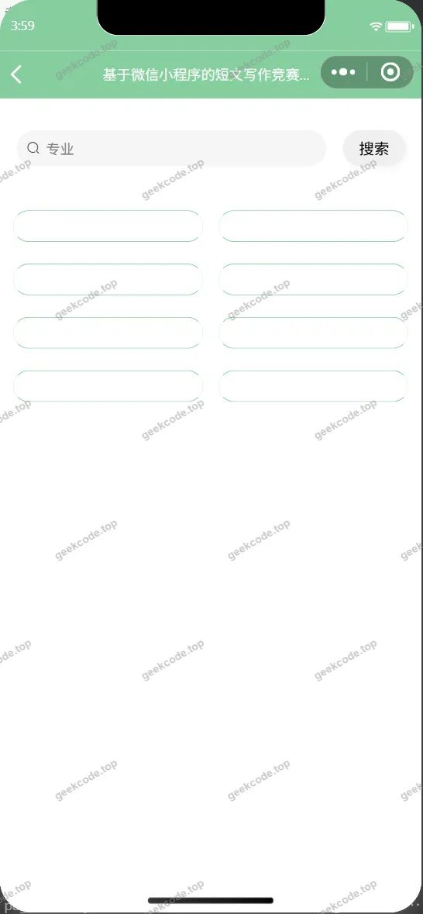</a><figcaption>小程序-管理端-专业列表</figcaption></figure>

<h3>后台管理端</h3>
<h4>后台-登录页</h4>

<a href="https://geekcode.top/archives/%E5%9F%BA%E4%BA%8E%E5%BE%AE%E4%BF%A1%E5%B0%8F%E7%A8%8B%E5%BA%8F%E7%9A%84%E7%9F%AD%E6%96%87%E5%86%99%E4%BD%9C%E7%AB%9E%E8%B5%9B%E7%AE%A1%E7%90%86%E7%B3%BB%E7%BB%9Fr653y-%E8%AE%BA%E6%96%87?utm_source=github" title="查看完整源码">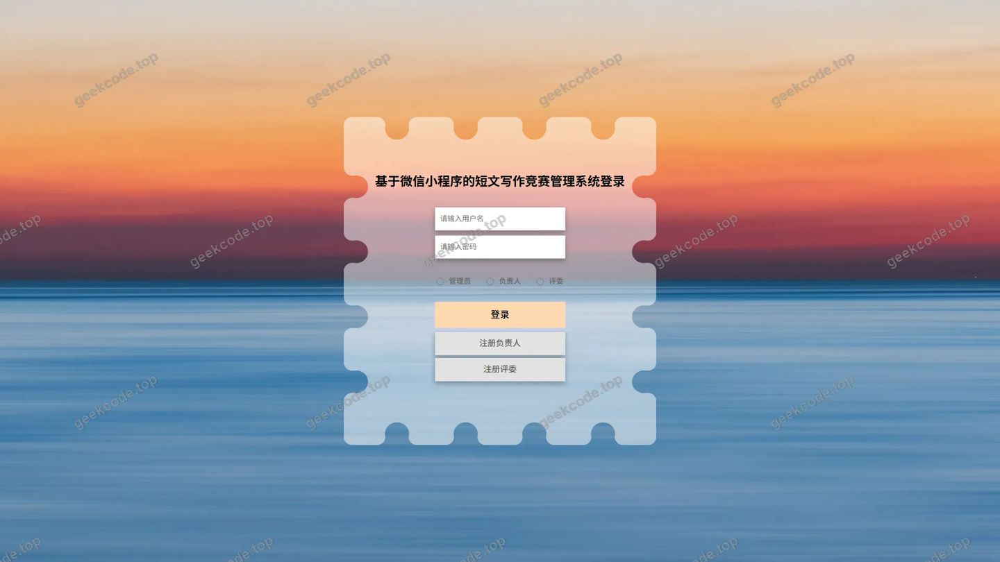</a>

<h4>后台-负责人</h4>

<a href="https://geekcode.top/archives/%E5%9F%BA%E4%BA%8E%E5%BE%AE%E4%BF%A1%E5%B0%8F%E7%A8%8B%E5%BA%8F%E7%9A%84%E7%9F%AD%E6%96%87%E5%86%99%E4%BD%9C%E7%AB%9E%E8%B5%9B%E7%AE%A1%E7%90%86%E7%B3%BB%E7%BB%9Fr653y-%E8%AE%BA%E6%96%87?utm_source=github" title="查看完整源码">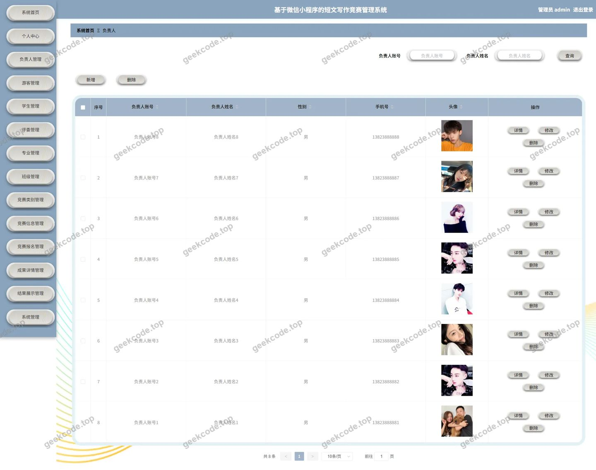</a>

<h4>后台-公告栏</h4>

<a href="https://geekcode.top/archives/%E5%9F%BA%E4%BA%8E%E5%BE%AE%E4%BF%A1%E5%B0%8F%E7%A8%8B%E5%BA%8F%E7%9A%84%E7%9F%AD%E6%96%87%E5%86%99%E4%BD%9C%E7%AB%9E%E8%B5%9B%E7%AE%A1%E7%90%86%E7%B3%BB%E7%BB%9Fr653y-%E8%AE%BA%E6%96%87?utm_source=github" title="查看完整源码">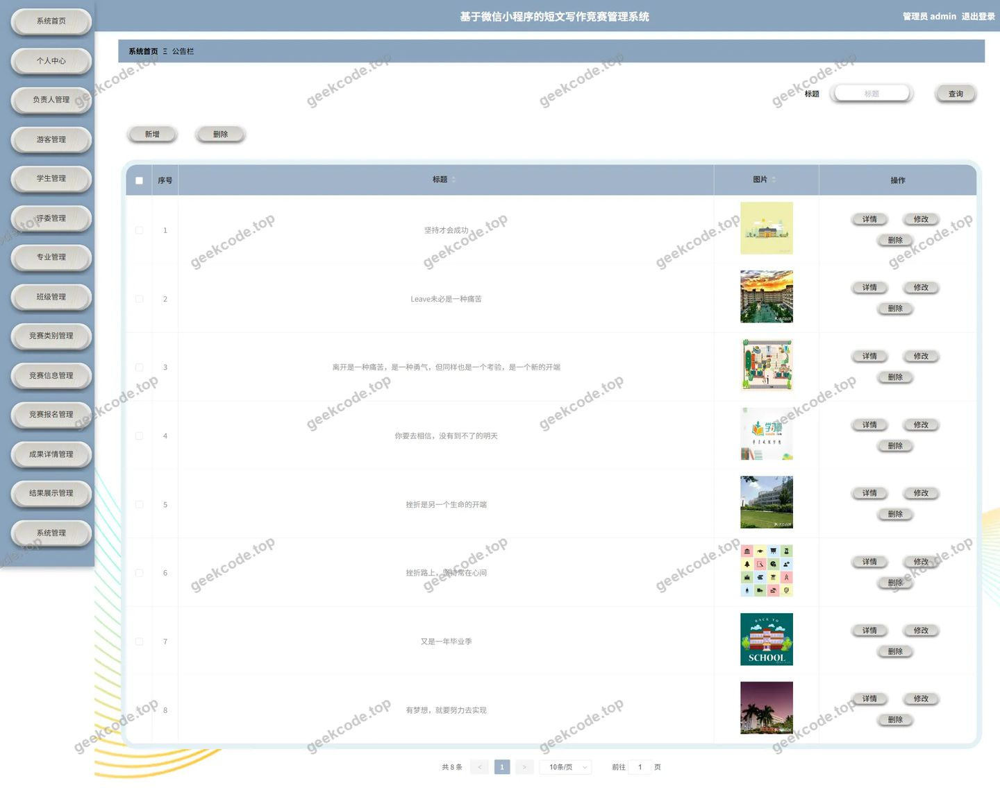</a>

<h4>后台-竞赛类别</h4>

<a href="https://geekcode.top/archives/%E5%9F%BA%E4%BA%8E%E5%BE%AE%E4%BF%A1%E5%B0%8F%E7%A8%8B%E5%BA%8F%E7%9A%84%E7%9F%AD%E6%96%87%E5%86%99%E4%BD%9C%E7%AB%9E%E8%B5%9B%E7%AE%A1%E7%90%86%E7%B3%BB%E7%BB%9Fr653y-%E8%AE%BA%E6%96%87?utm_source=github" title="查看完整源码">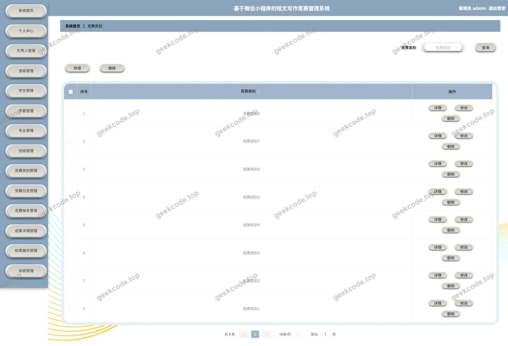</a>

<h4>后台-竞赛信息</h4>

<a href="https://geekcode.top/archives/%E5%9F%BA%E4%BA%8E%E5%BE%AE%E4%BF%A1%E5%B0%8F%E7%A8%8B%E5%BA%8F%E7%9A%84%E7%9F%AD%E6%96%87%E5%86%99%E4%BD%9C%E7%AB%9E%E8%B5%9B%E7%AE%A1%E7%90%86%E7%B3%BB%E7%BB%9Fr653y-%E8%AE%BA%E6%96%87?utm_source=github" title="查看完整源码">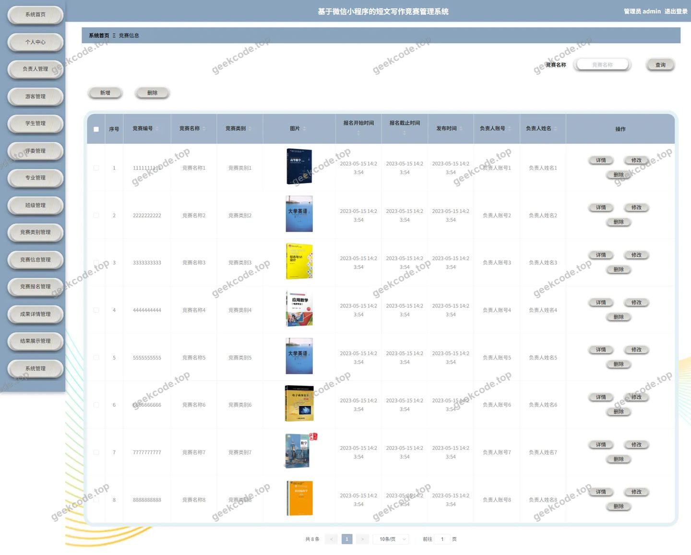</a>

<h4>后台首页</h4>

<a href="https://geekcode.top/archives/%E5%9F%BA%E4%BA%8E%E5%BE%AE%E4%BF%A1%E5%B0%8F%E7%A8%8B%E5%BA%8F%E7%9A%84%E7%9F%AD%E6%96%87%E5%86%99%E4%BD%9C%E7%AB%9E%E8%B5%9B%E7%AE%A1%E7%90%86%E7%B3%BB%E7%BB%9Fr653y-%E8%AE%BA%E6%96%87?utm_source=github" title="查看完整源码">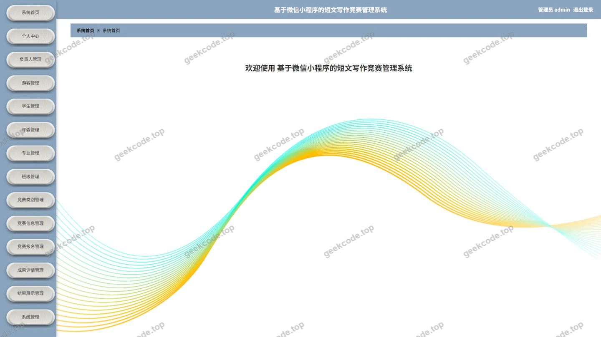</a>

<h4>后台-学生</h4>

<a href="https://geekcode.top/archives/%E5%9F%BA%E4%BA%8E%E5%BE%AE%E4%BF%A1%E5%B0%8F%E7%A8%8B%E5%BA%8F%E7%9A%84%E7%9F%AD%E6%96%87%E5%86%99%E4%BD%9C%E7%AB%9E%E8%B5%9B%E7%AE%A1%E7%90%86%E7%B3%BB%E7%BB%9Fr653y-%E8%AE%BA%E6%96%87?utm_source=github" title="查看完整源码">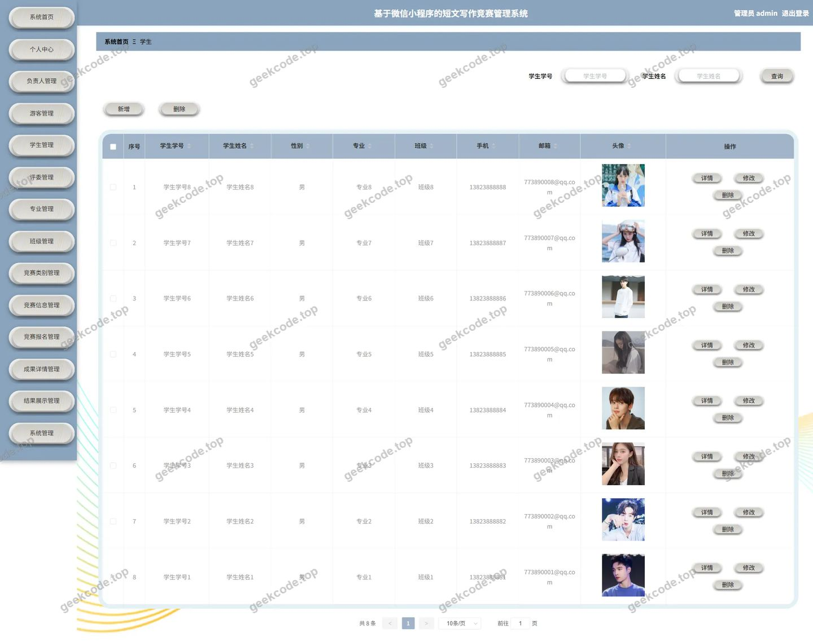</a>

<h4>后台-游客</h4>

<a href="https://geekcode.top/archives/%E5%9F%BA%E4%BA%8E%E5%BE%AE%E4%BF%A1%E5%B0%8F%E7%A8%8B%E5%BA%8F%E7%9A%84%E7%9F%AD%E6%96%87%E5%86%99%E4%BD%9C%E7%AB%9E%E8%B5%9B%E7%AE%A1%E7%90%86%E7%B3%BB%E7%BB%9Fr653y-%E8%AE%BA%E6%96%87?utm_source=github" title="查看完整源码">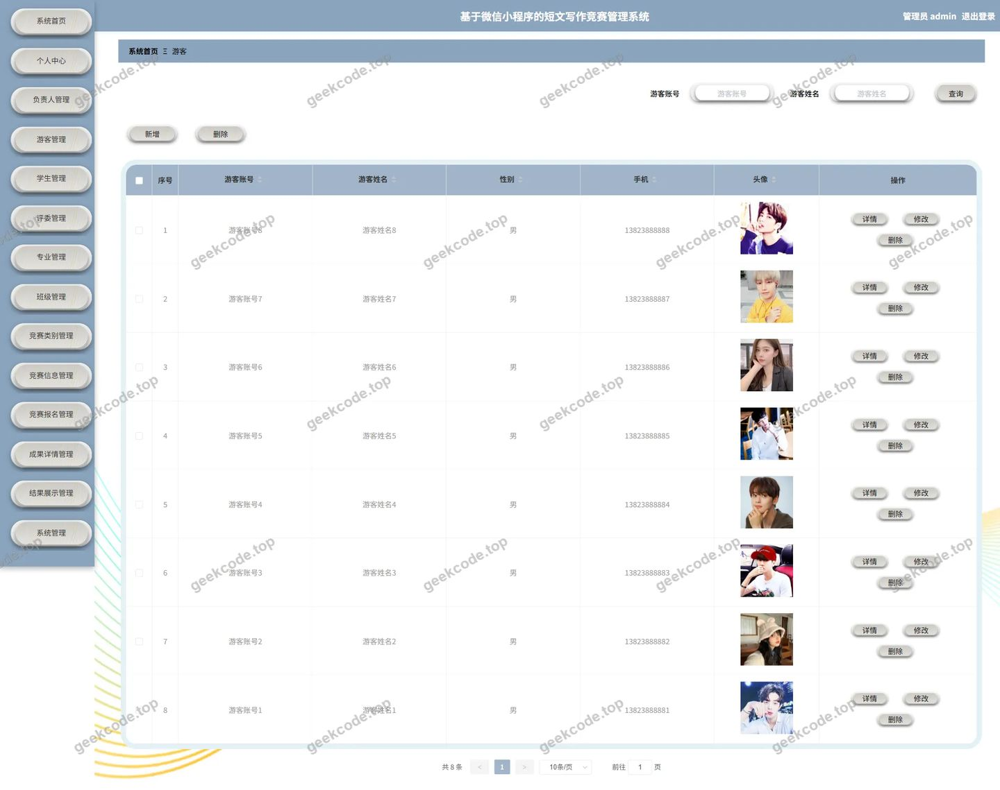</a>

---

## 获取完整源码

| 项目 | 说明 |
| --- | --- |
| 项目名 | 基于微信小程序的短文写作竞赛管理系统r653y--论文 |
| 运行截图 | 本文 26 张（站点带水印原图，仓库 `images/` 目录） |
| 完整源码 | [https://geekcode.top/archives/%E5%9F%BA%E4%BA%8E%E5%BE%AE%E4%BF%A1%E5%B0%8F%E7%A8%8B%E5%BA%8F%E7%9A%84%E7%9F%AD%E6%96%87%E5%86%99%E4%BD%9C%E7%AB%9E%E8%B5%9B%E7%AE%A1%E7%90%86%E7%B3%BB%E7%BB%9Fr653y-%E8%AE%BA%E6%96%87?utm_source=github](https://geekcode.top/archives/%E5%9F%BA%E4%BA%8E%E5%BE%AE%E4%BF%A1%E5%B0%8F%E7%A8%8B%E5%BA%8F%E7%9A%84%E7%9F%AD%E6%96%87%E5%86%99%E4%BD%9C%E7%AB%9E%E8%B5%9B%E7%AE%A1%E7%90%86%E7%B3%BB%E7%BB%9Fr653y-%E8%AE%BA%E6%96%87?utm_source=github) |
| 咨询微信 | **ir9372**（备注：jingpin-yuanma） |
| 更多项目 | [极客代码 geekcode.top](https://geekcode.top/?utm_source=github) |

> 需要源码、部署、改配置、跑不起来等问题，加微信 ir9372 沟通，说明项目名即可。
